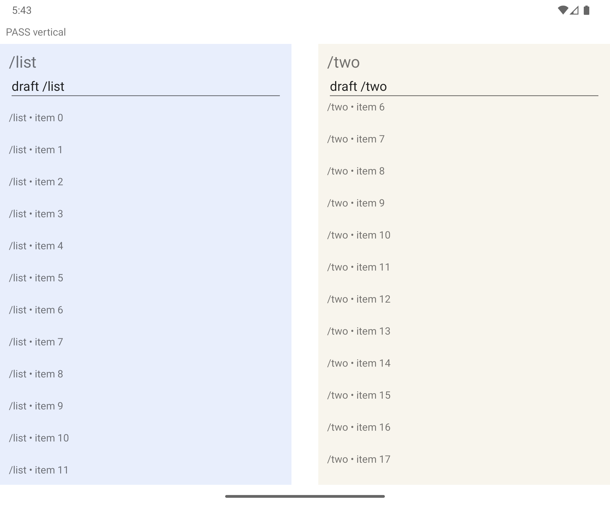

# Fold-aware split validation — #60

2026-10-19. NativeScript Android runtime 9.1.1, Core 9.1.3, NativeScript-Vue 3.1.2, AndroidX WindowManager/window-java 1.5.1. Local native runs used an Android 16 / API 36 Pixel Fold emulator (2208×1840 physical pixels, density 2.625).

## Native evidence

Both runs passed all **21 checkpoints**. The non-occluding run used PID `6875` and the occluding run used PID `6317`; every checkpoint in each run retained its original PID and native Page identities. Fixtures and commands are in [the native runner guide](../scripts/native/README.md#foldable-split-layout).

| Case                | Evidence                                                                                                                                                                                   |
| ------------------- | ------------------------------------------------------------------------------------------------------------------------------------------------------------------------------------------ |
| Flat fold           | Actual AndroidX feature reported nonseparating/NONE; ordinary width-based columns remained.                                                                                                |
| Book posture        | Hinge-angle sensor changed from 180° to 90°; native `FoldingFeature` became separating and panes occupied opposite sides of the fold.                                                      |
| Occluding hinge     | Android WindowManager Extensions `display_features=hinge-[1056,0,1152,1840]` reported FULL occlusion. Native Frame bounds excluded its 96-pixel width. The setting was restored afterward. |
| Tabletop posture    | Rotating the window transformed the native feature to horizontal; the same Frames used rows above/below the feature.                                                                       |
| RTL                 | With manifest RTL support enabled, the native layout direction moved the list to the right of the vertical hinge; LTR restored its original side.                                          |
| Opt-out             | Toggling `foldAware` retained history and switched to width-only geometry, then restored fold adaptation.                                                                                  |
| Modal               | Posture changed while a native modal was open; dismissal returned to the original detail Page and draft.                                                                                   |
| Resize and keyboard | Display resized to 1800×1600 and back while the editor retained focus, including the IME/inset shifts after modal return. Actual pane bounds were checked after native layout settled.     |
| State and Back      | List and both details retained Page references and drafts; current detail retained its native scroll offset. Back returned to the earlier detail and its original draft.                   |

The occluding feature comes from the emulator's **OS WindowManager Extensions settings provider**, then passes through real AndroidX callbacks and native layout. It is not an application-level mock or evidence from physical dual-screen hardware. The normal posture run uses the emulator hinge sensor and default device feature. No physical foldable was connected; no screen-reader speech claim is made.

### CI setup follow-up, 2026-10-20

Two CI boots reported no native feature after a sensor write, while the same
emulator version had passed earlier. CI creates its foldable geometry from a
Pixel 7 profile because older SDK catalogs lack Pixel Fold. The CI runs now pin
both the fold (`fold-[1104,0,1104,1840]`) and the occluding hinge through the OS
WindowManager Extensions settings provider, instead of depending on that
profile's default resource overlay for the first run. This provider is part of
[AOSP's native feature producer](https://android.googlesource.com/platform/frameworks/base/+/9b3b95f93ac95720ae04c2f69fb421ca6c6bb6da/libs/WindowManager/Jetpack/src/androidx/window/common/RawFoldingFeatureProducer.java).

Posture still comes from the emulator hinge sensor. The driver first exercises
the sensor and waits for Android's committed `HALF_OPENED`/`OPENED` state before
asserting app geometry. It saves `postures.json` and `device-state.txt`, including
on failure. No application callbacks or JavaScript fold data are substituted,
and the existing geometry, focus, identity and back assertions remain required.
The default-feature local mode remains available by omitting `FOLD_DISPLAY_FEATURES`.

## Implementation and regression coverage

- Each observer obtains the Activity from the mounted view's context, subscribes on load and removes its callback on unload/disposal. No foreground-Activity singleton selects its owner.
- Native pixel coordinates become view-local DIPs, including offsets and padding. Fold strips round outward because NativeScript string grid lengths truncate fractional DIPs.
- Pre-draw measurements catch parent/IME translation and RTL changes even when the split view's own layout bounds do not change. A changed geometry only updates existing row/column assignments, never reparents Frames or creates navigation entries.
- Unit coverage includes zero-width separating folds, nonseparating folds, fully occluding hinges, horizontal/vertical orientation, fractional dimensions, offsets, clipped edges, RTL, unavailable bridge, subscriptions/disposal, modal return and retained Frame/entry identities.
- Full suite: **435 passed, eight existing skips**; typecheck and package build pass. Demo typecheck/build, formatting and English/Portuguese documentation build pass.
- The `Native` workflow adds an API 35 Pixel Fold job with normal and OS-injected occluding feature runs, screenshots, PIDs, callback geometry and JSON results. CI results are recorded on the PR; the local device run above is API 36.

## Compatibility boundaries

The AndroidX dependency is optional and requires a native rebuild. Without it, on iOS, or without a relevant feature, existing width-based split behavior remains. `foldAware=false` explicitly disables the feature listener. The layout supports a single intersecting folding feature; it is not Activity embedding, multi-window restoration or a new navigation host. Existing NativeScript/application configuration-change and process-restoration policies remain responsible for Activity recreation.
